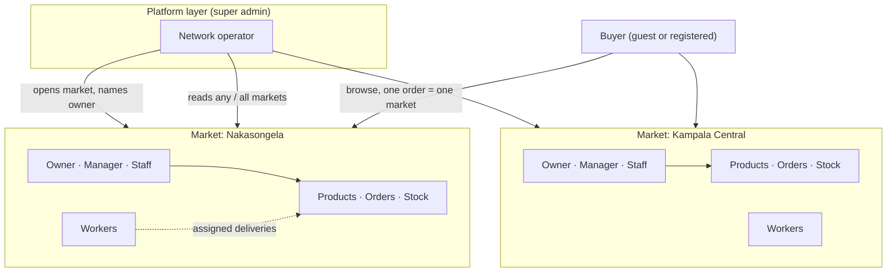
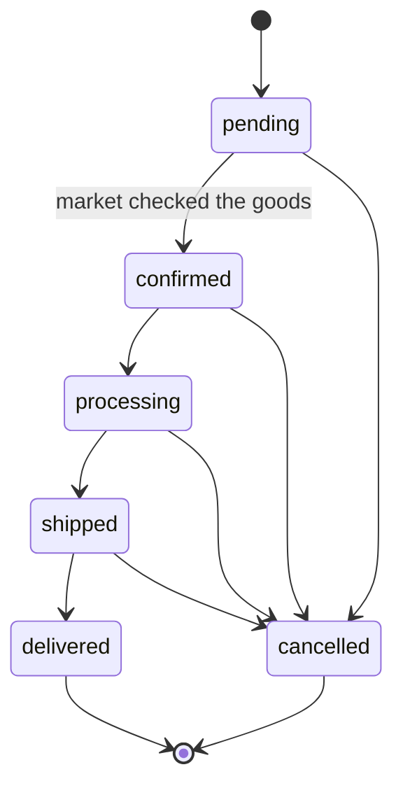
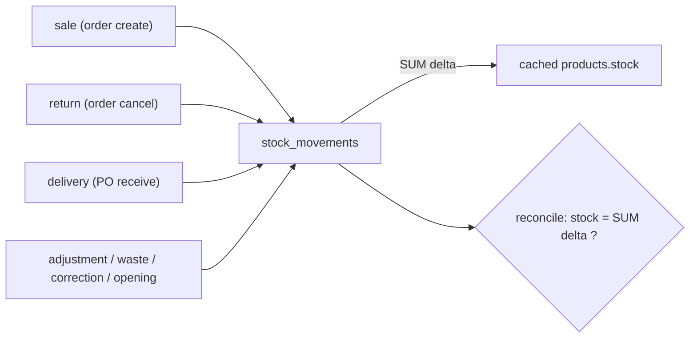

# Mu Katale — Full System Report

### An interlinked national network of Uganda's central markets, with centrally administered booking

| | |
| --- | --- |
| **Product** | Mu Katale — *"in the market"* (Luganda). Prices in Ugandan shillings (UGX). |
| **Category** | Multi-market grocery commerce platform (B2C + institutional), centrally operated. |
| **Origin** | Rebuilt from the Figma *Interactive Grocery Mobile App (Community)* into a working production system. |
| **Repository** | https://github.com/RWANGOGA/clone-central-market-repo |
| **Storefront** | https://rwangoga.github.io/clone-central-market-repo (GitHub Pages) |
| **API** | https://clone-central-market-repo-1.onrender.com (Render) |
| **Database** | Neon Postgres (production) · Docker Postgres 16 (development) |
| **Scale as shipped** | 121 commits · 31 tables · 74 API routes · ~25 storefront screens + an 8-panel staff console · 158 automated tests |

---

## Abstract

Mu Katale is a web platform that **interlinks Uganda's national central markets
into a single network** and lets anyone — a household buying vegetables or an
institution stocking a kitchen — order produce from them in one place.

It differs from a conventional marketplace in one structural decision: **booking
is administered centrally, not by independent vendors.** On a typical platform
each seller answers their own orders, sets their own stock and pockets their own
money, and the platform merely routes traffic. Here, orders are received,
allocated and fulfilled through a **platform layer** (super admins) and a
**per-market layer** (owners, managers, shop assistants). A market's staff see
only their market; the platform operator sees the whole network and is the only
actor who can found a new market. Stock is a reconcilable ledger, an order is an
auditable state machine, and money and fulfilment are deliberately separate
axes.

The result is a system that behaves like the national booking desk for many
markets while remaining deployable on free infrastructure — a React storefront on
GitHub Pages, a Next.js/Drizzle/Postgres API on Render, a Neon database — behind
an L3 security-reviewed, one-commit-per-change engineering process.

---

## 1. Executive summary

- **Two decoupled halves.** A mobile-first **storefront + staff console**
  (React 19 single-page app) and a **data-and-money API** (Next.js 15 route
  handlers over Postgres via Drizzle). They communicate only over HTTP and are
  hosted separately.
- **A network, not a shop.** Independent `markets` share one catalogue, one
  geography model, one ordering pipeline and one analytics surface, yet each
  market's orders, stock, people and cash are fenced from every other.
- **Three user classes.** General **buyers** (guests and registered customers),
  market **staff** (owner / manager / shop assistant), and the platform
  **super admin**. Access is a *role × market* boundary, enforced in the API on
  every request and mirrored in the console's navigation.
- **Integrity as the core deliverable.** Atomic stock reservation, a server-side
  order state machine, an append-only stock ledger with reconciliation, price
  history, optimistic concurrency, capability-token payment settlement, and a
  full activity audit.
- **Honest limits.** No live mobile-money gateway yet (cash-on-delivery settles
  end-to-end today); region/district boundaries are real but deeper outlines are
  empty; the live feed is single-instance. All stated plainly in §16.

---

## 2. Vision and intention

The stated direction (from the project's own framing and roadmap) is to grow into
a **sophisticated, national platform that interlinks all central markets and
manages bookings centrally rather than through individual vendors.** The intent is
operational as much as commercial:

1. **Interlinking.** Bring many physically separate central markets onto one
   digital network so a buyer sees national supply and a market gains reach
   without building its own technology.
2. **Central administration of booking.** The platform, not each vendor,
   guarantees that an order is honoured: stock is reserved on the platform's
   ledger, fulfilment moves through a controlled state machine, and refunds are
   recorded centrally. This is the "management-mediated" model that distinguishes
   Mu Katale from a listings site.
3. **Trust in every number.** Prices, stock and statuses must trace back to an
   event, so institutional buyers can rely on the platform for procurement, not
   just impulse shopping.
4. **Built for Ugandan reality.** Mobile money over card, a real administrative
   geography (region → district → sub-county → parish → village), maps over typed
   postcodes, and copy short enough for a low-literacy buyer.

The competitive benchmark named internally is **Twiga / Ocado** — supply-chain
platforms — with the roadmap toward a booking engine (delivery slots,
availability-to-promise), recurring orders, and full mobile-money settlement.

---

## 3. Problem statement and research foundation

`RESEARCH_FOUNDATION.md` documents the need-finding (interviews, an observation
protocol, personas). Five personas shape the feature set:

| Persona | Core need | Where the system answers it |
| --- | --- | --- |
| **Institutional procurement manager** | Bulk orders, dependable stock, spend audit | Server-priced orders, stock ledger, `admin_activity_log`, CSV export |
| **Market administrator** | Run their market only | Market-scoped console, role permission matrix |
| **Household buyer** | Fast, trustworthy path to mobile-money payment | Browse → basket → checkout → pay, price pinned to the buy button |
| **Delivery rider** | A destination they can physically reach | Geo hierarchy + "use my current location" reverse-geocoding + coverage map |
| **Low-literacy / extreme user** | Plain words, big targets, minimal typing | Accessibility pass (Pillar 1), map-driven location, short copy |

Four structural problems fell out of that research and drive the architecture:
**trust in numbers**, **real geography**, **local money**, and **multi-market
privacy**. Each is addressed below (§7 architecture, §9 workflows, §12 security).

---

## 4. What the system does — capabilities by actor

**A buyer can:** browse a live, searchable, sortable catalogue scoped to a market
location; open a product with its price and stock; add to a persistent basket (kept
in a server-side cart behind a cookie, so it survives reloads); apply a promo code;
choose a delivery location by cascading hierarchy **or** by sharing a live position
that the system reverse-geocodes to a district; place an order that immediately
reserves stock; pay by mobile money, wallet, or cash on delivery; add items to an
order that is already open; track the order's full status timeline; and, if
registered, manage saved addresses, reorder a past basket, set notification
preferences, and read an inbox. A guest tracks by order reference.

**Market staff can:** work a live order queue (auto-refreshing), search by
reference / customer name / phone, move an order through validated fulfilment
states, confirm or reject an order (with per-line rejection and a refund record),
run the catalogue (add/edit products, change prices, adjust stock, withdraw and
restore, bulk edit), watch inventory levels against per-product thresholds, view
the stock ledger and a reconciliation report, and — at manager level and above —
manage market workers, suppliers, purchase orders and promos.

**The platform operator (super admin) can additionally:** open and edit markets and
name each market's owner, manage admin accounts across the platform, deactivate
customers, switch the console's market context to read any market or the whole
network at once, and see network-wide analytics.

---

## 5. Actors and roles

Mu Katale models access as **two independent axes**: *what a role may do*
(permission matrix) and *which market it may do it in* (tenancy). The API enforces
both on every request; the console reflects them so the boundary is visible before
a request comes back empty.

### 5.1 General users — buyers

- **Guest.** Shops and orders without an account. Owns a server cart via the
  `mk_cart` cookie; receives a scoped, hashed `mk_order_tracking` cookie at order
  creation to prove the order is theirs for later tracking/payment. Keyed on phone;
  no password.
- **Registered customer.** Signs up with phone + password and is **auto-signed-in**
  (no OTP gate — an intentional open-registration decision). Gains a persistent
  profile: saved addresses, order history, reorder, notification preferences
  (e.g. farm-harvest alerts), and an inbox. Access via a hashed `mk_customer_session`
  cookie.

### 5.2 Market staff and the platform admin

Four admin roles, in a strict hierarchy **super > owner > manager > staff**
(`api/src/lib/adminPermissions.ts`, `ROLE_LABELS`):

| Role | Label | Scope | Can open a market? | Typical job |
| --- | --- | --- | --- | --- |
| `super` | **Super admin** | The whole platform (market_id null) | **Yes** (only tier that can) | Operate the network, found markets, name owners |
| `owner` | **Market owner** | One market | No | Run a market: shop, people, accounts, shoppers |
| `manager` | **Manager** | One market | No | Run the shop day-to-day; cannot touch accounts |
| `staff` | **Shop assistant** | One market | No | Fulfil orders and nothing else |

The permission matrix (writes gate money and stock; reads stay open to any signed-in
admin because a picker needs the catalogue and a manager needs the books):

| Permission | super | owner | manager | staff |
| --- | :-: | :-: | :-: | :-: |
| `orders.write` — update orders | ✓ | ✓ | ✓ | ✓ |
| `catalogue.write` — change the catalogue | ✓ | ✓ | ✓ | — |
| `inventory.write` — adjust stock | ✓ | ✓ | ✓ | — |
| `refunds.write` — record refunds | ✓ | ✓ | ✓ | — |
| `promos.write` — change promo codes | ✓ | ✓ | ✓ | — |
| `suppliers.write` — suppliers / purchase orders | ✓ | ✓ | ✓ | — |
| `workers.write` — market workers | ✓ | ✓ | ✓ | — |
| `customers.write` — customer access | ✓ | ✓ | — | — |
| `admins.write` — admin accounts | ✓ | ✓ | — | — |
| `markets.write` — open/change a market | ✓ | — | — | — |

> Note the design decision baked into the matrix: **founding a market belongs to the
> platform alone.** An `owner` runs a market but cannot create a rival — and the
> route also checks the account's pinned market, so even a promoted account cannot.

### 5.3 The tenancy boundary (market scoping)

`api/src/lib/marketScope.ts` answers *which* market a request may touch. A market
account is permanently pinned to its `marketId`; the super admin has none and may
read all. This boundary is applied to orders, catalogue, stock, workers, promos,
analytics, and — importantly — the **live order feed and system alerts** (they were
found crossing markets and fenced; commit 0184cc1). The console shows the current
market context in a permanent footer on the navigation rail, and switching market
remounts the active panel so nothing cached from the previous market lingers.

---

## 6. How the platform connects all the central markets

The network is not a metaphor — it is a data and control model:

- **One `markets` table, many tenants.** Every product, order, worker, promo and
  alert carries a `marketId`. `products.market_id` ties a listing to its market;
  `orders.market_id` ties an order to exactly one market.
- **One order, one market — by design.** If a basket mixes two markets, the API
  refuses with a clear message (`MIXED_MARKETS`), because the alternative — one
  payment, one stock draw and one delivery belonging to two markets at once — would
  give neither market's staff a complete, accountable picture.
- **The platform opens markets; owners staff them.** Only a super admin creates a
  market (via `POST /api/admin/markets`) and names its owner. A market account reads
  only its own market — a rival's name and count are simply never sent.
- **Workers belong to a market.** `market_workers` are assigned per market and
  orders are allocated to them (`POST /api/admin/orders/:id/assign`); the deliverer
  is not an account and never signs in.
- **Shared infrastructure, separate books.** All markets run on the same API,
  database, catalogue editor, order pipeline, geography model and analytics — but
  each sees its own slice. The buyer's storefront can switch market context; the
  console's market switcher lets the platform read any market or the whole network.



---

## 7. Architecture

### 7.1 Monorepo — two independent applications

```
clone-central-market-repo/
├── src/                 ← storefront + staff console (React 19 + Vite SPA)
│   ├── app/
│   │   ├── App.tsx       ← the orchestrator: routing, cart lifecycle, checkout→pay
│   │   ├── components/   ← ~25 screens + admin/ console + ui/ primitives
│   │   ├── lib/          ← API clients, providers, formatting, geo, currency
│   │   └── imports/      ← original Figma-export assets & SVG paths
│   ├── assets/           ← bundled product imagery
│   └── styles/           ← Tailwind v4 + design-token layer
├── api/                  ← data & money service (Next.js 15, own package.json/lockfile)
│   ├── src/app/api/      ← 74 route handlers (public shop + /api/admin)
│   ├── src/db/           ← schema.ts (31 tables), seeds, drizzle config
│   ├── src/lib/          ← 41 modules: auth, stock, orders, payments, analytics…
│   └── data/geo/         ← cached region/district boundaries (geoBoundaries, public domain)
├── render.yaml           ← Render blueprint for the API
├── Dockerfile.api/.frontend, nginx.conf, docker-compose.yml  ← container path (self-host/dev)
├── .github/workflows/    ← deploy-pages.yml (shop) + CI
├── ROADMAP.md            ← the phase plan, each phase marked DONE + verified
├── RESEARCH_FOUNDATION.md← need finding, personas, topic guide
└── DEPLOYING.md          ← bring-up order + cross-origin contract
```

The root `package.json` declares **no npm workspaces**, so the storefront and the API
install and build independently and never fight over dependencies. They meet only at
the HTTP boundary.

### 7.2 Frontend — `src/` (storefront + console)

| Concern | Choice |
| --- | --- |
| Framework | React 19.3 · Vite SPA · TypeScript `strict` |
| Routing | `react-router` 8; base name derived at build so it matches the `/<repo>/` Pages path |
| Styling | Tailwind v4 with a token layer (`theme.css`, `tailwind.css`) + shadcn-style primitives |
| Motion / maps | `framer-motion`; `leaflet` + `react-leaflet` for coverage and delivery maps |
| Fonts | Inter + Newsreader (self-hosted) |
| State | Context providers: `authProvider`, `cartProvider`, `topUpProvider` |
| API access | Typed clients per domain (`catalogue`, `cartApi`, `orderApi`, `paymentApi`, `customerApi`, `adminApi`, `geoApi`, `promoApi`, `stockApi`) over one `apiBase` |
| Offline resilience | The catalogue is read live; a fallback set compiled into `App.tsx` renders when the API is unreachable |

The API origin is baked in at build time (`VITE_API_BASE`) — it is not a secret (it
is visible in the bundle), and the Pages workflow asserts it and the asset base are
correct before publishing.

### 7.3 Backend — `api/` (data & money)

| Concern | Choice |
| --- | --- |
| Runtime | Next.js 15 App Router — **route handlers only** (an API, no pages) |
| Data access | Drizzle ORM 0.45 over `pg` |
| Validation | Zod 4 at every boundary |
| Language | TypeScript 5.9 · `strict` + `noUnusedLocals` + `noUnusedParameters` |
| Tests | vitest — 29 files, 158 passing assertions |
| Schema | Drizzle Kit `push` (no migration files; see §13.2) |

Route handlers split into a **public/customer surface** (`/api/products`, `/api/cart`,
`/api/orders`, `/api/payments`, `/api/geo`, `/api/customers`) and a **staff surface**
(`/api/admin/**`) where all authorisation lives.

### 7.4 Cross-cutting backend modules (`api/src/lib`)

`security` (CSRF) · `rateLimit` · `password` (hashing + one-time tokens) ·
`customerAuth`/`customerSession`/`customerDto`/`customerOrderView` ·
`adminAuth`/`adminPermissions`/`adminAccounts`/`marketScope` ·
`cartOwnership`/`orderOwnership` · `stockLedger`/`stock`/`stockErrors` ·
`orderFlow`/`orderLifecycle`/`orderEvents`/`orderMoney`/`orderInput`/`orderDetail`/
`orderTimeline`/`orderCancellation`/`cancelPolicy` · `pricing`/`promotions`/`promoRules` ·
`payments` · `analytics` · `activity` · `notifications` ·
`geoValidate`/`geoReverse`/`locationGuard` · `catalogue` · `uploads` ·
`webOrigins` · `env` · `http` · `dbErrors` · `clientIp`.

---

## 8. Pages and screens

### 8.1 Buyer storefront (routes in `src/app/App.tsx`)

| Route | Screen | Purpose |
| --- | --- | --- |
| `/` | `ProductListPage` | Shop front: location context, search box, sort, product grid, cart badge |
| `/product/:id` | `ProductDetailPage` | Full product, quantity, price pinned beside *Add to basket* |
| `/basket` | `BasketPage` | Line items, promo, totals, *Proceed to payment*; loading vs. empty states |
| `/checkout` | `CheckoutPage` | Delivery details + `GeoCascade` / "use my current location"; place order |
| `/pay/:reference` | `PaymentPage` | Choose channel and pay for the open order |
| `/order/:reference` | `OrderConfirmationPage` | Order status + timeline; a **Pay** button while payment is still owed |
| `/map` | `MapPage` | Interactive coverage map of Uganda (region → district) |
| `/news` | `NewsstandPage` | Marketplace news / notices |
| `/about` | `AboutPage` | What the platform is and how it works |
| `/login`, `/signup` | `LoginPage`, `SignupPage` | Customer authentication |
| `/profile` | `ProfilePage` | Orders, reorder, saved addresses, notification preferences, inbox |
| `/staff` | `AdminGate` → `AdminPage` | Staff sign-in, then the console |
| (drawer) | `Menu` | Shop navigation (Map, News, About, Staff, sign-in/profile) |
| (overlays) | `AddToCartOverlay`, `TopUpBar`, `StockBadge`, `DeliveryMap`, `DeliveryLocationMap` | Cross-cutting buying / top-up / stock / delivery-location UI |

### 8.2 Staff console (`AdminPage` + `admin/AdminSidebar`)

Navigation is a **left rail grouped into four sections**, filtered by role, with the
current market stated permanently at the foot:

| Section | Panels (tabs) | Who sees them |
| --- | --- | --- |
| **Fulfilment** | Orders · Inventory | all staff (Orders is the landing tab for `staff`) |
| **Catalogue** | Catalogue (views: All · Active · Withdrawn) | manager and up (`staff` is read-only, no write) |
| **Insight** | Analytics · Customers | manager and up (Customers write needs owner/super) |
| **Setup** | People (workers) · Markets · Admins | People = manager+; **Markets = super only**; Admins = owner+ |

The landing tab depends on role (`staff` → Orders; everyone else → Catalogue). Panels
that edit money or stock call `/api/admin/*` endpoints that re-check the permission
matrix server-side, so the UI filter is convenience, not the boundary.

---

## 9. Workflows

### 9.1 Buyer purchase journey

```mermaid
flowchart LR
  browse[Browse / search] --> detail[Product detail]
  detail --> cart[Add to basket]
  cart --> basket[Basket + promo]
  basket --> checkout[Checkout + location]
  checkout -->|POST /api/orders| order[Order created · stock reserved · cart rotated]
  order --> pay["/pay/:reference"]
  pay -->|payment intent| settled[Awaiting approval / COD done]
  settled --> track["/order/:reference timeline"]
  track --> profile[Profile: history, reorder, notifications]
```



### 9.2 Order creation — one transaction, many invariants

`POST /api/orders` runs inside a single `db.transaction`:

1. **Freeze the cart** with a compare-and-set (`active → checkout`); a second
   concurrent attempt finds no row to update and throws `CART_ALREADY_USED` → 409.
2. Read line items; refuse inactive products; enforce **one order = one market**.
3. Compute the subtotal on the server; if a promo is present, lock the row
   (`FOR UPDATE`), validate it against the market, and **claim the redemption in-transaction**.
4. **Draw stock down through the ledger** (`reason:'sale'`), refusing to oversell;
   a shortfall raises `StockConflict` → 409 naming the product.
5. Insert `orders`, `order_items`, an opening `order_status_events` row; mark the cart `converted`.

After commit: a best-effort inbox notification for signed-in buyers that
**cannot fail the order**, and a tracking token for guests. The client rotates to a
fresh cart immediately so a spent basket can never be reused.

### 9.3 Fulfilment vs. money — two separate axes

`orders.status` models **fulfilment only**; `payments.status` models **money**. A paid
but unshipped order is simply `processing`. Transitions are validated server-side
(`lib/orderFlow.ts`) because the browser is not the only caller:



`confirmed` is the market asserting it has inspected the goods — the step the buyer
testing report asked for by name — and **payment does not set it**. An illegal move
returns 409 listing the legal ones. Every transition writes an `order_status_events`
row in the same transaction, so the timeline can never drift from the order's real state.

### 9.4 Payment flow and settlement

`POST /api/payments/intents` creates a payment for an existing order. The amount is
read from the order, never the request. Channels:

| Channel | Instrument rules | Settlement |
| --- | --- | --- |
| **Mobile money** (MTN MoMo, Airtel Money, UTel) | A Ugandan number validated against the chosen network's prefixes (MTN 077/078/079, Airtel 070/075, UTel 071); a mismatch names the right network | `awaiting_approval` — provider reports back |
| **Wallet** | A wallet number or `name@bank` address | `awaiting_approval` |
| **Cash on delivery** | No instrument | Recorded as owed (`cod`); staff mark collected; the order still awaits `confirmed` |
| **Card** | **Refused by the API** | A hosted gateway page owns the PAN; no card number ever reaches this server |

- **Authorise by the order, not the spent cart** (the latest fix): because checkout
  consumes the cart, the buyer's current cart is no longer the order's cart by the
  time they pay, so the intent is gated on order ownership — a registered customer by
  session, a guest by the `mk_order_tracking` cookie, which is scoped to `/api` so it
  also reaches the payment route.
- **Asynchronous approval without a gateway yet:** until a real gateway is wired, the
  browser that opened the intent reports the result using a **one-time settlement
  token** — only its SHA-256 is stored, compared in constant time, and cleared on use,
  so a reference alone cannot mark a payment paid. Simulated settlement is disabled in
  production, where only the gateway webhook may settle.

### 9.5 Adding items to an order that is already open (finding F1)

Because the cart is consumed at order time, the buyer would otherwise be stuck.
`POST /api/orders/:id/items` tops up the *open* order: it re-uses the money-axis lock,
keeps the one-market rule, reserves the extra stock through the ledger, re-evaluates
the promo, and voids any stale pending payment so the buyer pays the new total once.

### 9.6 Confirmation, rejection and refunds (finding F2)

The market's first decision is `confirmed`, one edge before fulfilment. A market can
`POST /api/admin/orders/:id/reject` a whole order or a single line: a rejected
`order_items` row is **never deleted** — its `line_status` becomes `rejected` with a
`rejection_note`, keeping the customer's original request, the refund's reference and
the record a later dispute is answered from. A refund row is written on the money axis.

### 9.7 Stock as a reconcilable ledger (Phase 2)



`products.stock` is a **cached total**; the only sanctioned writer is
`stockLedger.recordMovement`, which applies a signed delta inside the enclosing
transaction and refuses to drift negative. Cancellation returns stock with a movement
whose `reference` is the order reference; receiving a purchase order writes one
`delivery` movement per line and refuses double-receive. A reconciliation query
(`stock <> SUM(delta)`) is expected to return nothing — and does. Low-stock alerts are
**derived** from live stock against each product's own threshold, never stored (a
stored alert goes stale the moment stock moves).

### 9.8 Staff console workflow

```mermaid
flowchart TB
  login[Staff sign-in /staff] --> gate{role?}
  gate -->|staff| orders[Orders queue]
  gate -->|manager+| cat[Catalogue · Inventory · Analytics]
  gate -->|owner+| ppl[People · Customers · Admins]
  gate -->|super| mk[Markets · all markets switch]
  orders --> queue[Live queue (SSE + 30s poll)]
  queue --> move[Advance status · confirm · reject]
  move --> led[Timeline event + stock/refund effects]
```

The queue updates without a manual refresh via a **Server-Sent Events** feed
(`GET /api/admin/events`, 25s heartbeat), with 30s polling underneath as a safety net.
New orders arrive on the stream within ~2s, scoped to the reader's market.

### 9.9 Authentication flows

- **Customer.** `POST /api/customers/signup` (phone + password, auto sign-in, no OTP);
  `login`; `session` to resume; hashed `mk_customer_session` cookie; logout clears it.
- **Admin.** `POST /api/admin/login` with a bcrypt-style hash and a throttled
  `admin_login_attempts` guard; `me` to resume; session cookie; a self-service
  `password` change. Accounts come from environment variables or the console, never
  the repository.

### 9.10 Geography and location flow (finding F3)

`GET /api/geo/hierarchy` serves the region → district → sub-county → parish → village
tree; the storefront cascade (`GeoCascade`) shows only levels that actually have data.
"Use my current location" sends a device pin to `GET /api/geo/reverse`, which clips to
the Uganda bounding box and runs point-in-polygon over the cached district outlines to
produce a valid region/district. The pin is persisted in the order's `shippingAddress`
JSON and preferred by the delivery map, while routing stays on the validated
region/district — a pin outside Uganda simply fails the guard like any bad location.

---

## 10. Data model (31 tables, by domain)

| Domain | Tables | Notes |
| --- | --- | --- |
| **Catalogue** | `products`, `product_price_history`, `markets`, `market_workers` | `products.stock` is a cached total; `market_id` ties listings to a market |
| **People & auth** | `customers`, `customer_sessions`, `customer_addresses`, `customer_preferences`, `admins`, `admin_sessions`, `admin_login_attempts` | sessions/tokens stored hashed |
| **Basket** | `carts`, `cart_items` | cart status `active → checkout → converted` prevents double-spend |
| **Orders** | `orders`, `order_items`, `order_status_events` | denormalised `region/district/phone/customer_name` for indexed search & analytics |
| **Money** | `payments`, `refunds`, `promo_codes` | money axis separate from fulfilment |
| **Inventory & procurement** | `stock_movements`, `suppliers`, `purchase_orders`, `purchase_order_items` | ledger is the source of truth |
| **Geography** | `regions`, `districts`, `sub_counties`, `parishes`, `villages` | deeper levels modelled, served empty |
| **Messaging & audit** | `notifications`, `admin_activity_log` | append-only; notifications market-scoped |
| **Abuse control** | `rate_limits` | backs the rate limiter |

Timestamps are UTC strings (`"YYYY-MM-DD HH:MM:SS"`) throughout for portability across
SQLite's heritage and Postgres; every enum is enforced in the application layer, and
indexes exist on the columns analytics and search read constantly
(`orders.created_at/status/region/phone/customer_id`, `order_items.product_id`,
`stock_movements.product_id/created_at`, notification and activity indexes).

---

## 11. API surface (74 routes, grouped)

- **Public shop:** `products` (+ `/[id]`), `cart` (+ `/items`), `orders`
  (+ `/[id]`, `/items`, `/cancel`, `/reorder`), `payments/intents` (+ `/[reference]`,
  `methods`, `webhook`), `geo` (`hierarchy`, `validate`, `locate`, `reverse`,
  `boundaries/[level]`), `inventory`, `promo/validate`, `assets/[...path]`, `health`.
- **Customer:** `customers/signup`, `login`, `session`, `me`, `me/orders`,
  `password`, `addresses` (+ `/[id]`), `preferences`, `notifications`.
- **Staff (`/api/admin/**`, session-guarded + permission-checked):** `login`, `logout`,
  `me`, `password`, `admins`, `markets`, `workers`, `customers` (+ `deactivate`),
  `orders` (+ `assign`, `collect-cash`, `refunds`, `reject`, `sweep`), `events` (SSE),
  `inventory` (`movements`, `reconciliation`, `products/[id]`), `products` (+ `bulk`,
  `restore`, `price-history`), `promos`, `suppliers`, `purchase-orders` (+ `receive`,
  `cancel`), `analytics` (`sales`, `products`, `regions`, `forecast`, `activity`,
  `export`), `notifications`.

---

## 12. Security and integrity model

Authorisation was treated as a phase, not a coat of paint.

- **Closed live holes (Phase 0).** An audit found four unauthenticated mutating routes
  (`PATCH /api/orders/:id`, `GET /api/orders`, `PATCH /api/inventory`,
  `PATCH /api/payments/intents`). Each was removed or moved behind a session-guarded
  `/api/admin/*` route; payment settlement now demands a capability token. 44
  assertions confirmed the fixes against a live server.
- **Two-axis access control.** The role matrix (§5.2) × market tenancy (§5.3), enforced
  on every request, including the SSE feed and system alerts.
- **Payment integrity.** Amounts from the order; promos claimed under a row lock; stock
  reserved transactionally; single-use settlement tokens compared in constant time.
- **CSRF & abuse.** `csrfCheck` compares Origin/Host against an allow-listed web-origin
  set (`webOrigins`); `rateLimit` guards order and payment attempts per IP and per
  order; admin login is throttled.
- **Object ownership.** `requireCart` (via the `mk_cart` owner token) and `ownsOrder`
  (customer session or the guest `mk_order_tracking` cookie) gate per-resource access;
  tracking and settlement tokens are stored hashed.
- **Credentials.** Passwords hashed; sessions/tokens are opaque and hashed at rest; all
  secrets and admin accounts come from the environment and are git-ignored.
- **Process.** Every push to `main` is preceded by an **L3 deep security review** (the
  most recent runs returned 0 findings).
- **Resilience.** A committed order is never failed by a post-commit notification; DB
  errors are mapped to clear responses rather than raw stack traces.

---

## 13. Hosting and deployment

### 13.1 Split-hosted topology

| Tier | Where | How |
| --- | --- | --- |
| **Storefront** | GitHub Pages | `deploy-pages.yml` builds with Vite and publishes the artifact from `main`. `VITE_BASE` is derived from `configure-pages`; `dist/404.html` is published as the SPA deep-link fallback (Pages serves it with a 404 status — expected, and the router still renders the screen). |
| **API** | Render | `render.yaml` runs `api/` as a native Node/web service (`rootDir: api`), plan `free`, region **Ohio**, `autoDeployTrigger: commit` with a **build filter** on `api/**` and `render.yaml`. `buildCommand: npm ci --include=dev && npm run build`, `startCommand: npm start`, `healthCheckPath: /api/health`. |
| **Database** | Neon Postgres | Reached via a **pooled** `DATABASE_URL` (`?sslmode=require`). Ohio ↔ Neon `aws-us-east-2` are co-located (the Render→Neon hop is what costs, ~180ms from Kampala). |

The shop calls the API **cross-origin**, so the contract is explicit and verified:
`WEB_ORIGINS` allows only `https://rwangoga.github.io`; responses carry
`Access-Control-Allow-Origin` + `Allow-Credentials`; session cookies are
`SameSite=None; Secure`; `TRUST_PROXY=true` so rate-limiting and the audit log record
the real client IP from `X-Forwarded-For`. A stranger origin gets no CORS headers at
all. `NODE_VERSION` is pinned to 22.20.0 to match CI and the Docker build. The free
tiers carry limits documented for demos: Render sleeps after 15 idle minutes, its
filesystem is wiped on restart (uploads go to `/tmp`), and Neon suspends after 5 idle
minutes with 1 GB storage / 100 compute-hours a month — they stop answering, they never
delete data.

`Dockerfile.api`, `Dockerfile.frontend`, `nginx.conf` and `docker-compose.yml` provide a
container path for self-hosting or development; the live Render service builds natively
rather than through `Dockerfile.api`.

### 13.2 Schema synchronisation

There are no committed migration files, so `drizzle-kit migrate` (run by the Docker
entrypoint) is a **no-op**; the schema arrives via `npm run db:push`, which diffs
`src/db/schema.ts` against the database. A production incident proved the point: the
API served code ahead of the Neon schema (`order_items.line_status`, then
`notifications.market_id`), surfacing as 500s on order and notification reads. The
durable fix is now wired in: `render.yaml` runs
`preDeployCommand: npm run db:push`, so **every deploy reconciles the schema before the
new instance takes traffic** — additive-only in practice, and drizzle aborts rather than
dropping data if a diff would be destructive.

### 13.3 Continuous integration

`.github/workflows` typechecks both applications and runs the API suite. The Pages
build asserts that the baked-in API origin and the asset base are correct before
publishing — because a wrong base is a blank page, not an error message, so it is
proved rather than trusted.

---

## 14. Advantages and value proposition

- **Network reach without vendor tooling.** Markets join one platform and inherit a
  catalogue editor, ordering pipeline, stock ledger, payments, geography and analytics
  they could not each afford to build.
- **Central accountability.** Booking is administered, not merely routed: the platform
  guarantees stock is reserved, orders advance through a controlled machine, and refunds
  are recorded — the trust institutional buyers need.
- **Numbers you can audit.** Every stock figure reconciles to a ledger; every price
  change has history; every status change and staff action is attributable. A dispute is
  answered from records, not memory.
- **Genuine multi-tenancy.** Hard market boundaries in the API (not just the UI) keep
  competing markets' data apart on shared infrastructure.
- **Built for Uganda.** Mobile-money-native, map-driven location, plain copy, and
  accessible down to a low-literacy or shared-phone buyer.
- **Cheap to run, real in behaviour.** The whole system runs on free tiers behind a
  security-reviewed pipeline while behaving like a conventional three-tier product.
- **Honest maturity.** Known gaps are documented rather than hidden, so stakeholders
  can plan the booking engine and gateway on top of a sound integrity core.

---

## 15. Quality, testing and engineering discipline

- **Strict typing everywhere** — `tsc --noEmit` gates both apps; unused locals/params
  are errors, so dead imports cannot survive a change.
- **158 automated tests** (29 files) covering the security and money paths: admin
  login security, market scoping, super-role, withdraw/restore, cart security, customer
  login/signup security, guest + general order security, order top-up, **payment access**,
  public-product security, plus unit tests for pricing, promotions, payments, order
  flow/money/timeline/events, rate limiting, DB errors, market scope, web origins,
  client IP and admin permissions.
- **Live verification before each ship.** Changes are exercised against a running
  server — e.g. the payment-intent fix was proven end-to-end (order → rotate cart → pay
  with the new cart id → 201; an unowned reference → 404), and each phase in the roadmap
  is marked **Verified** with assertion counts.
- **One verified commit per logical change;** every shipped buyer-side fix traces back
  to the user-testing finding that justified it.

---

## 16. Development history (dependency-ordered phases)

| Phase | Delivered |
| --- | --- |
| **0** | Closed unauthorised mutating routes; split fulfilment from money; validated order state machine; settlement capability token. |
| **1** | Order management: `order_status_events` timeline, denormalised searchable location, indexes, admin order endpoints, **SSE live feed** + polling fallback, order queue UI. |
| **2** | Inventory: `stock_movements` ledger as source of truth, `recordMovement`, per-product thresholds, derived low-stock, reconciliation, suppliers + purchase orders, cancel-returns-stock, atomic order draw-down. |
| **3** | Dynamic products: `product_price_history`, `updated_at` optimistic concurrency, bulk edit, withdraw/restore, rejection of silent stock writes. |
| **4** | Analytics & reporting: `admin_activity_log` audit, sales/products/regions/forecast/activity endpoints, CSV export. |
| **Pillar 1** | Accessibility (keyboard + screen reader), responsive/viewport work, CI typecheck for the front end. |
| **Buyer-side F1–F4** | Top-up an open order; a real confirmation step with line-level rejection/refund; reverse-geocode "use my current location"; price brought above the fold. |
| **Deployment hardening** | Non-fatal post-commit notifications; pre-deploy schema reconciliation; payment authorised by order. |

---

## 17. Roadmap and known limitations (stated plainly)

**Deliberate gaps today**

- **No live payment gateway.** Mobile-money intents wait on a provider; only cash on
  delivery settles end-to-end. Real charging needs a gateway wired to
  `/api/payments/webhook` (its HMAC verification is already in place).
- **Empty deep boundaries.** Sub-county/parish/village are modelled and served, but no
  open dataset publishes those outlines; region/district come from geoBoundaries
  (gbOpen ADM1/ADM2, public domain). The map says so rather than drawing an empty frame.
- **Process-local live feed.** Correct for a single instance; multi-instance/serverless
  would need Redis or a DB-backed stream — covered meanwhile by 30s polling.
- **Single-location stock.** No multi-warehouse split yet; that means moving stock to a
  `(product_id, location_id)` key and picking a location per order draw.
- **Some staff screens hidden, not removed.** The market-scoped console cut the
  suppliers / purchase-order / promos / activity *panels* to keep the day's work
  front-and-centre; their tables, `/api/admin/*` routes and tests remain, so restoring
  one is a tab + panel, not a rebuild.

**Where it is headed**

A national booking engine on top of the integrity core: delivery slots and
availability-to-promise, recurring orders, richer search, full mobile-money settlement,
surfacing the whole market network to buyers, and a firmer design-system foundation —
benchmarked against supply-chain platforms like Twiga and Ocado.

---

## 18. Appendix — headline metrics & glossary

| Metric | Value |
| --- | --- |
| Commits on `main` | 121 |
| Database tables | 31 |
| API route handlers | 74 |
| Backend library modules | 41 |
| Frontend library modules | 17 |
| Storefront screens | ~13 routes / 25 components |
| Staff console panels | 8 (grouped into 4 sections) |
| Automated tests | 158 (29 files) |
| Admin roles | 4 (`super`, `owner`, `manager`, `staff`) |
| Order fulfilment states | `pending → confirmed → processing → shipped → delivered` (+ `cancelled`) |
| Payment channels | Mobile money (MTN/Airtel/UTel) · wallet · cash on delivery · card (hosted gateway only) |
| Hosting | GitHub Pages (shop) · Render Ohio (API) · Neon `aws-us-east-2` (DB) |

**Glossary**

- **Central management / management-mediated** — booking and fulfilment run by the
  platform and per-market staff, not by independent vendors.
- **Interlinked network** — many independent `markets` sharing one API, catalogue,
  ordering pipeline, geography and analytics while remaining data-isolated.
- **Stock ledger** — the `stock_movements` event log; `products.stock` is a cache derived
  from it, making every quantity reconcilable.
- **Money axis vs. fulfilment axis** — `payments.status` (has the cash arrived?) is kept
  separate from `orders.status` (where is the order in being filled?).
- **Capability token** — a single-use secret (payment settlement, guest order tracking)
  that authorises an action without exposing the underlying resource id.
- **Tenancy / market scope** — the boundary that pins an admin's reads and writes to one
  market (or, for super, the whole network).

**One-line stack:** React 19 · Vite · Tailwind v4 · react-router 8 · framer-motion ·
Leaflet — Next.js 15 route handlers · Drizzle ORM · PostgreSQL (Neon) · Zod · vitest —
hosted on GitHub Pages + Render + Neon, gated by CI and an L3 pre-push security review.
